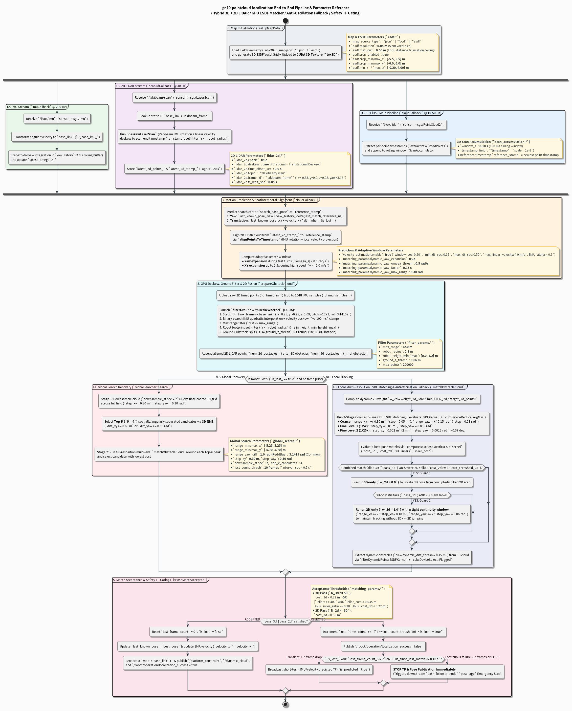
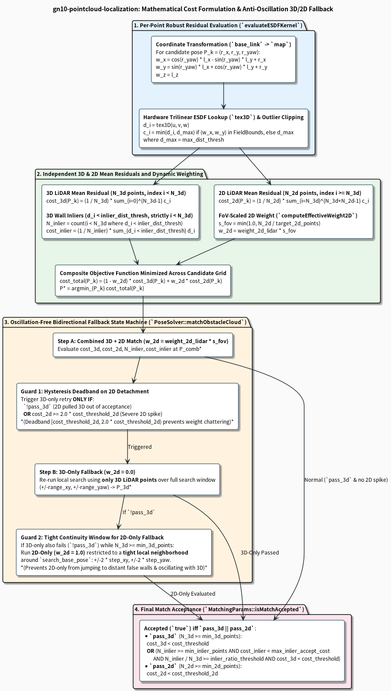

# gn10-pointcloud-localization

[Japanese](./README_jp.md)

Real-time LiDAR self-localization using ESDF, GPU 3D Texture Memory, Jetson Orin Nano, and Livox MID360.
Estimates the robot's pose from LiDAR point clouds without requiring wheel odometry or prior initial pose inputs via fast and lightweight static map matching.
Successfully deployed for autonomous navigation and positioning in NHK Robocon 2026.


## 1. Overview & Key Features

- GPU-accelerated self-localization optimized for Jetson Orin Nano.
- Matches point clouds against a continuous Euclidean Signed Distance Field (ESDF) rather than point-to-point, providing clean extensibility and low computational overhead.
- Evaluates distance queries in $\mathcal{O}(1)$ time per point via GPU 3D Texture Memory and hardware trilinear interpolation.
- Supports automatic ESDF map generation from `.pcd` point clouds and `.json` CAD geometric definitions via a dedicated binary format.
- Built for ROS 2 Humble for straightforward integration across robotic projects.
- Features real-time dynamic obstacle filtering that separates non-map objects and publishes them to `/dynamic_cloud`.
- Instead of relying on odometry, the system performs high-speed matching against a static map; this minimizes systematic error bias and enables real-time position estimation within that static map.

<p align="center">
  <video src="https://github.com/user-attachments/assets/c095bf62-cfac-403c-aa1b-679e0ed4c053" width="80%" controls></video>
</p>

## 2. System Architecture & Localization Algorithm

```
[3D LiDAR (Livox MID360)] ──> [ScanAccumulator (0.10s Deskew)] ──> [GroundFilter (CUDA)] ──> [3D Obstacle Cloud]
                                                                                                     │
[2D LiDAR (Lakibeam 1)]   ──> [LaserScanDeskew (Rot + Trans + Time Sync)] ─────────────────> [2D Obstacle Cloud]
                                                                                                     │
[IMU + EMA Velocity Extrapolation] ──────────────────────────────────────────────────────────>       ▼
                                                                                    [ESDF Matcher (CUDA 3D Texture)]
[3D ESDF Map (GPU Texture)] ─────────────────────────────────────────────────────────────────>       │
      │                                                                                              ▼
      ▼ (Transient Local)                                                   [Anti-Oscillation 3D/2D Fallback & Gating]
[ESDF Cloud (/esdf_map)]                                                                             │
                                                                          ┌──────────────────────────┴──────────────────────────┐
                                                                          ▼ (Accepted)                                          ▼ (Rejected)
                                                         [Publish TF (map -> base_link)]                       [Halt TF & Pose Output Immediately]
                                                         [/platform_constraint & /dynamic_cloud]                [localization_success = false]
                                                         [localization_success = true]                          [Trigger GlobalSearch after 25 frames]
```

## 3. Build Environment & Dependencies

- **OS**: Ubuntu 22.04 LTS
- **ROS**: ROS 2 Humble
- **GPU**: NVIDIA GPU (Compute Capability 8.7 / 8.9: Jetson Orin Nano / AGX Orin / RTX 40 series, etc.)
- **CUDA Toolkit**: 12.0 or higher

### Installing Dependencies & Building

```bash
sudo apt update
sudo apt install -y \
  libceres-dev \
  libeigen3-dev \
  nlohmann-json3-dev \
  libpcl-dev \
  libopenmpi-dev \
  ros-humble-pcl-conversions

cd ~/ros2_ws
colcon build --symlink-install --packages-select gn10_pointcloud_localization
source install/setup.bash
```

## 4. Usage

### Placing Map Files
Place map files (`.pcd`, `.esdf`, `.json`) into the package's `map/` directory. They can then be referenced by file name in the YAML configuration.

### Pre-converting PCD to ESDF
```bash
# Usage: pcd_to_esdf_converter <input.pcd> <output.esdf> <resolution_m> [max_dist_m] [min_x max_x min_y max_y min_z max_z]
ros2 run gn10_pointcloud_localization pcd_to_esdf_converter \
  ~/ros2_ws/src/gn10-pointcloud-localization/map/my_field.pcd \
  ~/ros2_ws/src/gn10-pointcloud-localization/map/my_field.esdf \
  0.05 0.50 -5.5 5.5 -6.0 6.0 -0.2 4.0
```
When running with `map_source_type: "pcd"`, a binary cache is automatically generated at `map/cache/<filename>.esdf` on first startup for faster subsequent loads.

### Launch
```bash
# Standard launch (common_params.yaml + localization_params.yaml)
ros2 launch gn10_pointcloud_localization localization.launch.py

# Launch using simulation time (e.g. for rosbag playback)
ros2 launch gn10_pointcloud_localization localization.launch.py use_sim_time:=true
```

## 5. Parameter Reference

Common parameters are defined in [`config/common_params.yaml`](./config/common_params.yaml).

| Parameter Name | Default (`common_params.yaml`) | Description & Mechanism |
| :--- | :---: | :--- |
| `map_source_type` | `"json"` | Map format (`json`, `pcd`, `esdf`, `ros2_param`). |
| `map_file_path` | `""` | Map file name or path (relative paths search within `map/`). |
| `esdf.resolution` | `0.05` | 3D ESDF voxel grid cell resolution [m]. |
| `esdf.max_dist` | `0.50` | Maximum Euclidean distance truncation limit in ESDF voxels [m]. |
| `esdf.crop_enabled` | `true` | Restrict ESDF grid generation to the specified 3D bounding box when loading PCD maps. |
| `esdf.crop_min_x` / `crop_max_x` | `-5.5` / `5.5` | ESDF crop minimum/maximum X coordinate [m]. |
| `esdf.crop_min_y` / `crop_max_y` | `-6.0` / `6.0` | ESDF crop minimum/maximum Y coordinate [m]. |
| `esdf.min_z` / `max_z` | `-0.20` / `4.00` | ESDF crop minimum/maximum Z coordinate [m]. |
| `scan_accumulation.window_s` | `0.10` | 3D LiDAR accumulation window [s] (deskewed to newest point timestamp). |
| `filter_params.ground_z_thresh` | `0.06` | Floor plane removal height threshold [m] relative to `base_link`. |
| `filter_params.robot_radius` | `0.80` | Robot chassis self-exclusion radius [m] (XY plane). |
| `filter_params.robot_height_min` / `max` | `0.0` / `1.2` | Robot chassis self-exclusion height range [m] (Z direction). |
| `filter_params.max_range` | `12.0` | Maximum effective detection range [m]. |
| `matching_params.search_range_xy` | `0.30` | Local tracking XY search half-window [m]. |
| `matching_params.search_step_xy` | `0.05` | Local coarse search XY grid step [m]. |
| `matching_params.search_range_yaw` | `0.15` | Local coarse search yaw half-window [rad]. |
| `matching_params.search_step_yaw` | `0.03` | Local coarse search yaw grid step [rad] (~$1.7^\circ$). |
| `matching_params.fine_refine` / `levels` | `true` / `2` | 2-stage $5 \times 5 \times 5$ sub-voxel refinement (`0.05 m` $\to$ `0.002 m`). |
| `matching_params.max_dist_thresh` | `0.25` | Per-point Huber/L1 residual distance clipping ceiling [m]. |
| `matching_params.dynamic_dist_thresh` | `0.15` | Distance threshold [m] above which points are extracted as `/dynamic_cloud`. |
| `matching_params.cost_threshold_3d` | `0.23` | Independent 3D LiDAR mean residual acceptance threshold [m] ($C_{\text{3D}} < 0.23\text{ m}$). |
| `matching_params.cost_threshold_2d` | `0.04` | Independent 2D LiDAR mean residual acceptance threshold [m] ($C_{\text{2D}} < 0.04\text{ m}$, hysteresis detachment at $2\times = 0.08\text{ m}$). |
| `matching_params.inlier_dist_thresh` | `0.08` | Distance threshold [m] to classify an obstacle point as a wall inlier. |
| `matching_params.min_inliers` | `400` | Minimum inlier point count for inlier-based acceptance ($N_{\text{inlier}} \ge 400$). |
| `matching_params.inlier_cost_thresh` | `0.035` | Maximum mean residual of inlier points for inlier acceptance [m] ($C_{\text{inlier}} < 0.035\text{ m}$). |
| `matching_params.min_inlier_ratio` | `0.28` | Minimum inlier ratio against 3D obstacle points ($N_{\text{inlier}} / N_{\text{3D}} \ge 0.28$). |
| `matching_params.max_inlier_accept_cost` | `0.25` | 3D residual cost upper bound guard for inlier acceptance [m] ($C_{\text{3D}} < 0.25\text{ m}$). |
| `matching_params.weight_2d_lidar` | `0.40` | Base weight $w_{\text{2D,base}}$ of 2D LiDAR residual term in Combined mode. |
| `matching_params.min_2d_points` / `target_2d_points` | `30` / `200` | Minimum 2D point threshold and reference point count for 100% FoV scaling. |
| `matching_params.min_3d_points` | `50` | Minimum 3D obstacle points (falls back to full-window 2D-only mode $w_{\text{2D}} = 1.0$ if fewer). |
| `matching_params.dynamic_yaw_expansion` | `false` | Dynamically widens yaw search window up to `0.60 rad` during fast turns ($|\omega_z| > 0.50\text{ rad/s}$, factor `0.5`). |
| `velocity_estimation.enable` | `true` | Enables linear velocity estimation with EMA smoothing ($\alpha = 0.6$) and constant-velocity extrapolation (`window_sec: 0.20`, `min_dt_sec: 0.15`, `max_dt_sec: 0.50`, `max_linear_velocity: 4.0`). |
| `lidar_2d.enable` / `deskew` | `true` / `true` | Enables Lakibeam 2D LiDAR, rotational/translational deskew, and time synchronization to 3D reference timestamp. |
| `lidar_2d.time_offset_sec` | `0.0` | Static timestamp offset [s] added to 2D LiDAR scan timestamps. |
| `global_search.top_k_candidates` | `4` | Number of Top-K spatially distinct local minima refined via NMS during global recovery. |
| `global_search.lost_count_thresh` | `25` | Consecutive failed frame threshold before triggering full-field global search. |

## 6. Diagrams





## 7. License

This repository is released under the [Apache 2.0 LICENSE](./LICENSE).
