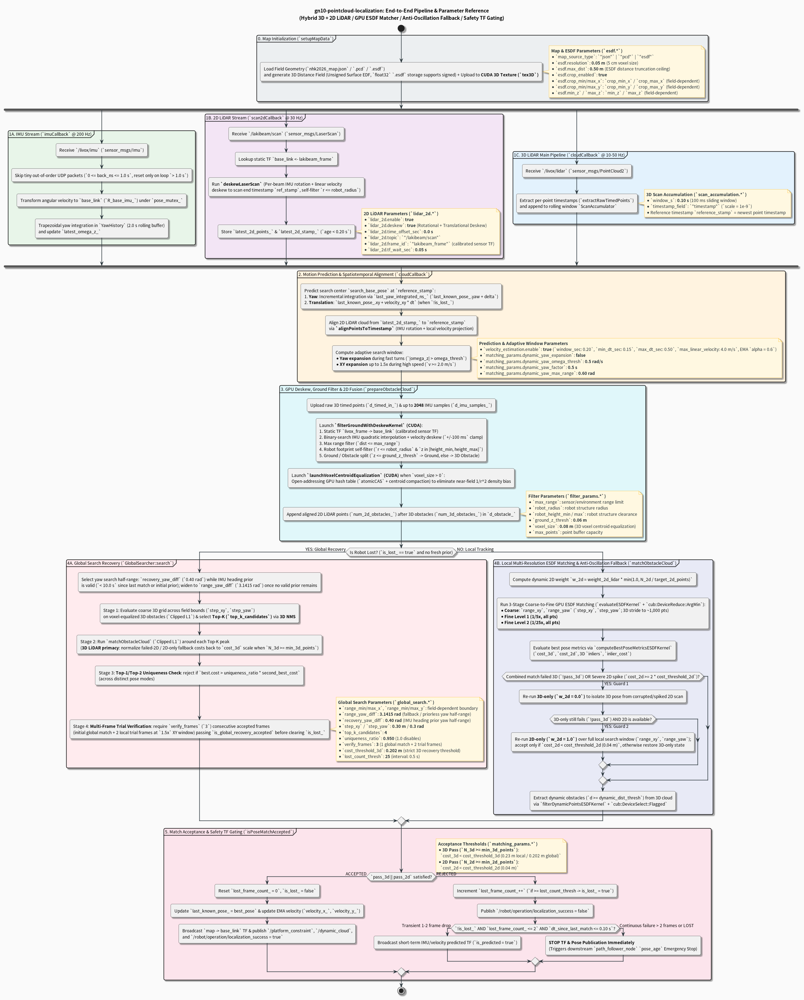
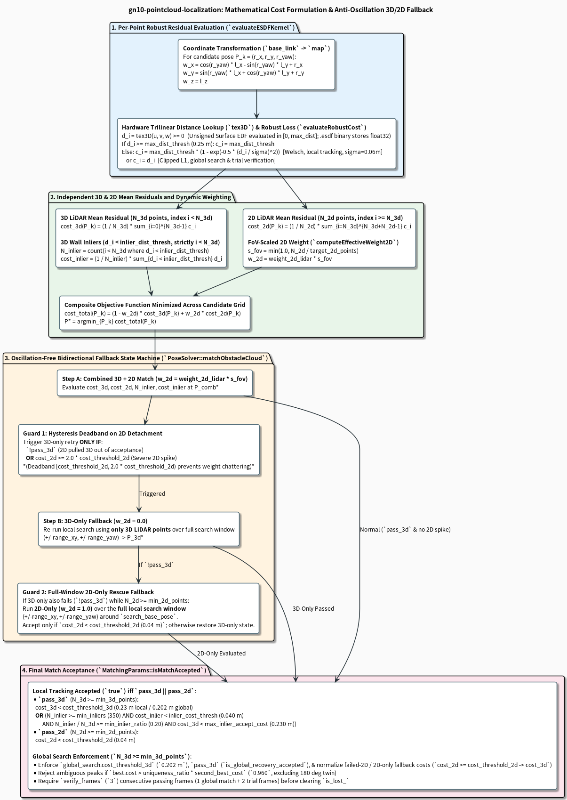

# gn10-pointcloud-localization

[日本語](./README_jp.md)

Planar 3-DoF $(x, y, \psi)$ LiDAR--IMU localization on static prior maps using CUDA 3D Texture Memory (`tex3D`) for ROS 2 Humble.
Estimates robot pose directly against a precomputed 3D distance field without wheel odometry or a prior initial pose.
Used for autonomous navigation and positioning in KOSEN Robocon 2026.


## 1. Key Features

- **Hardware-interpolated 3D EDF (`tex3D`)**: Compiles `.json` CAD definitions or `.pcd` point clouds offline into a Truncated Unsigned Surface Euclidean Distance Field ($d \in [0, d_{\max}]$; stored in `.esdf` float32 binary files) and binds it to read-only CUDA 3D Texture Memory for $O(1)$ hardware trilinear lookup.
- **GPU Preprocessing & Voxel Equalization**: Accumulates `0.10 s` of 3D LiDAR packets with IMU yaw + EMA planar velocity deskewing, removes chassis/ground returns, and runs a fixed-memory GPU spatial hash table (`262,144` slots, `6.00 MiB` VRAM, `0.08 m` voxels) to equalize near-field $1/r^2$ density bias.
- **Direct Clipped $L_1$ Matching**: Coarse-to-fine planar 3-DoF grid search down to `2 mm` / `0.0012 rad` using pure Clipped $L_1$ (`max_dist_thresh = 0.25 m`) and independent threshold gating (`cost_3d < 0.23 m`). Optional rear 2D LiDAR fusion/fallback is also supported.
- **GPU Global Relocalization**: Reuses the same `tex3D` EDF volume on cold start or after `25` consecutive rejected frames (Top-4 3D NMS, Top-1/Top-2 ratio gating `0.950`, and 3-frame trial verification at `cost_3d < 0.202 m`).
- **Dynamic Obstacle Extraction**: Publishes unmapped non-static points ($d \ge 0.15\,\text{m}$) on `/dynamic_cloud`.

https://github.com/user-attachments/assets/c095bf62-cfac-403c-aa1b-679e0ed4c053

## 2. Pipeline Overview

```text
[3D LiDAR (50 Hz)] ──> [0.10 s IMU Deskew & Filter] ──> [GPU Hash Voxel Equalizer (0.08 m)] ──┐
[2D LiDAR (opt.) ] ──> [Per-Beam Deskew & Time Sync] ─────────────────────────────────────────┤
[IMU + EMA Vel.  ] ──> [Pose Prediction] ─────────────────────────────────────────────────────▼
[Static 3D EDF   ] ──> [CUDA 3D Texture (tex3D)] ──> [Coarse-to-Fine Clipped L1 Matcher (2 mm)]
                                                                   │
                                        ┌──────────────────────────┴──────────────────────────┐
                                        ▼ (cost_3d < 0.23 m)                                  ▼ (Rejected)
                       [Publish TF (map -> base_link)]                       [Halt TF & Pose Output]
                       [/platform_constraint & /dynamic_cloud]               [After 25 frames -> GPU Global Search]
                                                                             [(Top-4 NMS + Ratio Gate + 3-Frame Verify)]
```

## 3. Requirements & Build

- **OS / ROS**: Ubuntu 22.04 LTS, ROS 2 Humble
- **GPU / CUDA**: NVIDIA GPU (Compute Capability 8.7 / 8.9, e.g., Jetson Orin Nano, RTX 4060), CUDA Toolkit 12.0+

```bash
sudo apt update && sudo apt install -y \
  libeigen3-dev nlohmann-json3-dev libpcl-dev libopenmpi-dev ros-humble-pcl-conversions

cd ~/ros2_ws
colcon build --symlink-install --packages-select gn10_pointcloud_localization
source install/setup.bash

# Run unit tests
ctest --test-dir build/gn10_pointcloud_localization --output-on-failure -V
```

## 4. Usage

Place `.json`, `.pcd`, or `.esdf` map files inside `map/`. When loading a `.pcd` map (`map_source_type: "pcd"`), a binary cache is automatically saved to `map/cache/<name>.esdf`.

```bash
# Optional: pre-convert .pcd to .esdf
ros2 run gn10_pointcloud_localization pcd_to_esdf_converter \
  map/my_field.pcd map/my_field.esdf 0.05 0.50 -5.5 5.5 -6.0 6.0 -0.2 4.0

# Launch (live or rosbag playback)
ros2 launch gn10_pointcloud_localization localization.launch.py
ros2 launch gn10_pointcloud_localization localization.launch.py use_sim_time:=true
```

## 5. Key Parameters (`config/common_params.yaml`)

| Parameter | Default | Description |
| :--- | :---: | :--- |
| `map_source_type` / `map_file_path` | `"json"` / `""` | Map format (`json`, `pcd`, `esdf`, `ros2_param`) and path (relative paths search `map/`). |
| `esdf.resolution` / `max_dist` | `0.05` / `0.50` | 3D EDF voxel size [m] and truncation ceiling [m]. |
| `esdf.crop_enabled` | `true` | Crop grid to bounding box (`crop_min/max_x,y`, `min/max_z`). CAD adds $\pm d_{\max}$ padding; cropped PCD omits padding. |
| `scan_accumulation.window_s` | `0.10` | 3D LiDAR sliding-window accumulation duration [s]. |
| `filter_params.voxel_size` | `0.08` | GPU hash voxel centroid size [m] (`<= 0` disables). |
| `filter_params.ground_z_thresh` | `0.06` | Floor removal height threshold [m] in `base_link`. |
| `filter_params.robot_radius` / `max_range` | `0.80` / `12.0` | Self-chassis cylinder exclusion radius [m] (`z` in `[0.0, 1.2]`) and max range [m]. |
| `matching_params.search_range_xy` / `step_xy` | `0.30` / `0.05` | Local coarse XY search half-window and grid step [m]. |
| `matching_params.search_range_yaw` / `step_yaw` | `0.15` / `0.03` | Local coarse yaw search half-window and grid step [rad]. |
| `matching_params.fine_refine` / `levels` | `true` / `2` | Two $5 \times 5 \times 5$ refinement levels (`0.05 m` $\to$ `0.002 m`, `0.0012 rad`). |
| `matching_params.max_dist_thresh` | `0.25` | Per-point Clipped $L_1$ residual ceiling [m]. |
| `matching_params.cost_threshold_3d` / `2d` | `0.23` / `0.04` | Independent 3D / 2D mean residual acceptance thresholds [m]. |
| `matching_params.dynamic_dist_thresh` | `0.15` | Distance threshold [m] for `/dynamic_cloud` extraction. |
| `matching_params.inlier_dist_thresh` | `0.08` | Wall-inlier distance threshold [m] (diagnostic telemetry only). |
| `lidar_2d.enable` / `deskew` | `true` / `true` | Optional 2D LiDAR fusion (`weight_2d_lidar: 0.40`, `min_2d_points: 30`) and per-beam deskew. |
| `velocity_estimation.enable` | `true` | EMA ($\alpha = 0.6$) planar velocity prediction (`window_sec: 0.20`, `max_linear_velocity: 4.0`). |
| `global_search.range_yaw_diff` / `recovery_yaw_diff` | `3.1415` / `0.40` | Full-yaw vs. IMU-prior-bounded yaw search half-range [rad]. |
| `global_search.top_k_candidates` / `uniqueness_ratio` | `4` / `0.950` | Top-K NMS peaks and Top-1/Top-2 ratio gate across distinct pose modes. |
| `global_search.verify_frames` / `cost_threshold_3d` | `3` / `0.202` | Consecutive passing frames and strict 3D cost threshold [m] required for recovery. |
| `global_search.lost_count_thresh` | `25` | Consecutive rejected frames before triggering global search. |

## 6. Architecture Diagrams





## 7. Benchmark Summary (`v1.4.0`, 3D LiDAR + IMU, Clipped $L_1$)

Measured on Desktop (Ryzen 7 5700X + RTX 4060) and Jetson Orin Nano (`25 W` mode, `tegrastats` total module `VDD_IN`, `4.5 W` idle). Public datasets (Dataset R1 in-arena & Dataset S1 Unity 6 Physics GT): <https://doi.org/10.5281/zenodo.24369541>. Reproduction commands: [`benchmarks/README.md`](./benchmarks/README.md).

| Benchmark | Desktop (RTX 4060) | Jetson Orin Nano (`25 W`) |
| :--- | :--- | :--- |
| **EDF Lookup Micro-Bench (`240×260×104`)** | `tex3D` `1.80×–3.38×` vs. Glob8 (`4.62×–8.65×` vs. Analytic) | `tex3D` `1.76×–3.44×` vs. Glob8 (`5.16×–11.5×` vs. Analytic) |
| **R1 Close-Human Stationary (`40–65 s`, Ref-Free)** | $\sigma_{xy}$ `242.3 → 5.3 mm` (`-97.8%`), max `16.1 mm`, `0` jumps (`0.55 ms`) | $\sigma_{xy}$ `238.5 → 5.2 mm` (`-97.8%`), max `16.9 mm`, `0` jumps (`5.15 ms`, `5.09 W`) |
| **R1 Full Arena Run (`20–280 s`, `50 Hz`)** | `0.56 / 0.65 ms` mean/p95 (`0` lost, `25.0 mm` inlier res., `5.9 mm` jitter) | `5.37 / 6.63 ms` mean/p95 (`5.09 W`, `0` lost, `25.0 mm` inlier res.) |
| **S1 Unity 6 Physics GT (`50 Hz` PCD / CAD)** | `12.7` / `18.8 mm` mean (`15.4` / `20.8 mm` RMSE, `0.58–0.59 ms`) | `13.4` / `18.6 mm` mean (`15.9` / `20.6 mm` RMSE, `5.43–5.90 ms`, `5.1 W`) |
| **Global Relocalization (S1 `N=8` / R1 `8+2`)** | S1 `8/8` (`5.15 ms`, `16.9 mm`); R1 `7/8` (`6.99 ms`), `2/2` neg. rejected (`0` FP) | S1 `8/8` (`34.8 ms`, `14.5 mm`); R1 `7/8` (`60.8 ms`), `2/2` neg. rejected (`0` FP) |
| **P1 Public `hdl_501` (Handheld 6-DoF, No IMU)** | `0.79 ms` (`0.348 m` 3-DoF RMSE vs. `0.045 m` 6-DoF NDT-OMP) | `6.42 ms` (`4.79 W`, `3.9×–23.0×` faster than NDT/DLL/GICP) |

**Scope & Trade-offs**:
- Planar 3-DoF $(x, y, \psi)$ assumes near-level motion; under handheld vertical walking motion without IMU (`hdl_501`), 6-DoF methods achieve higher accuracy.
- Dense 3D CUDA Arrays scale as $O(V / r_{\text{grid}}^3)$ in map volume $V$, targeting medium-scale static indoor spaces (tens of meters).
- Requires an NVIDIA CUDA GPU and uses `168–223 MiB` host RSS.

**S1 Unity 6 Physics GT:**

https://github.com/user-attachments/assets/490dc752-1bef-429f-99ad-afc3ba2bac26

## 8. License

Licensed under the [Apache 2.0 License](./LICENSE).
