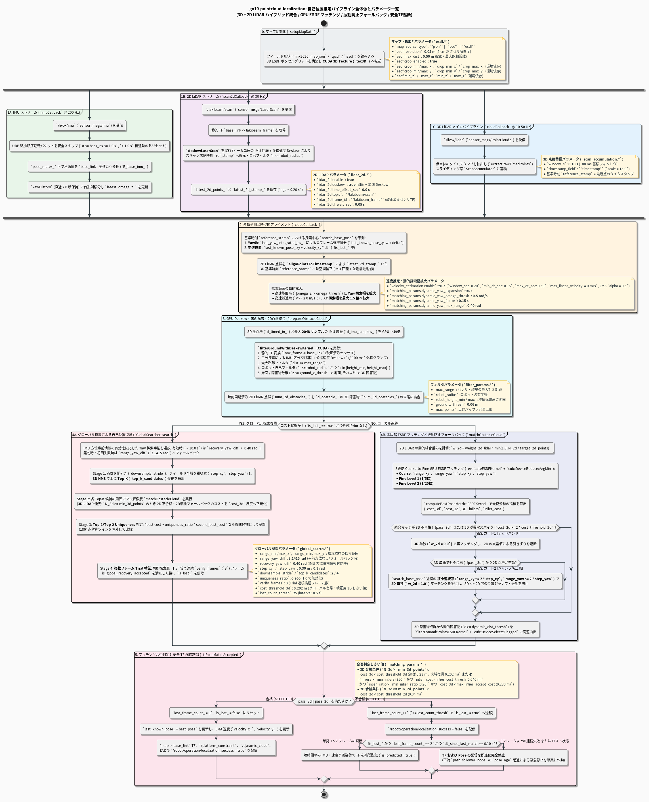
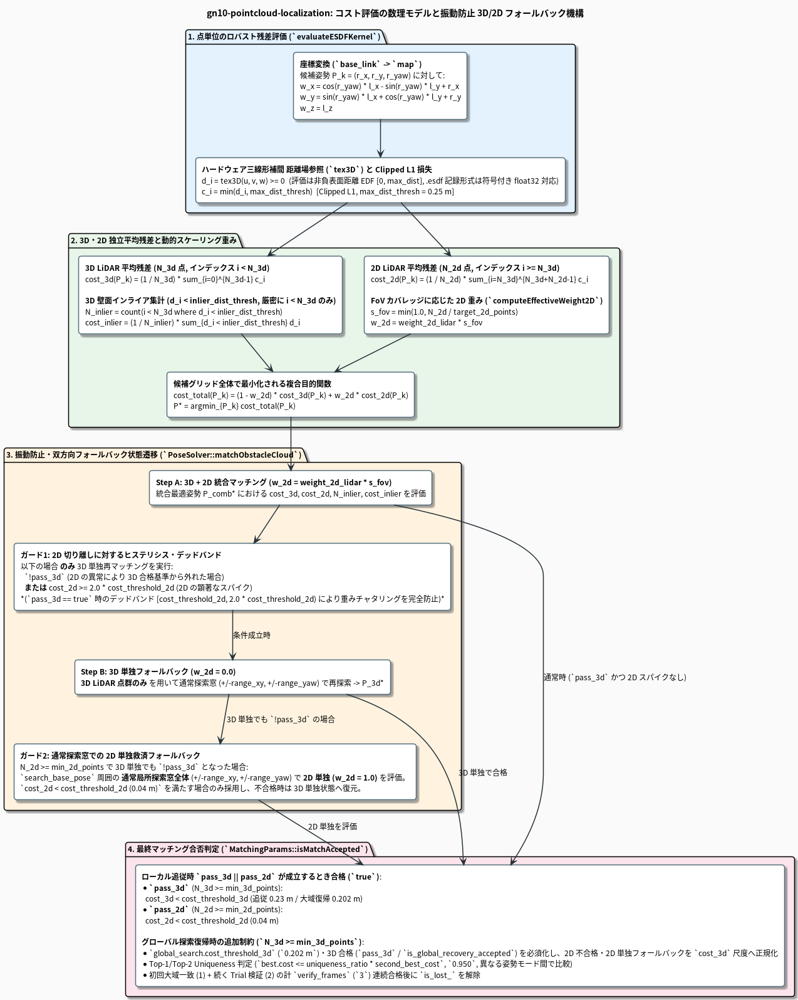

# gn10-pointcloud-localization

[English](./README.md)

ESDF + 3D Texture Memory + Jetson Orin Nano + Livox Mid-360S を用いた自己位置推定。
高速で軽量な静的マップマッチング技術によって、初期位置やオドメトリ無しでLiDAR点群から自己位置を推定します。
NHK高専ロボコン2026においてフィールド上でロボットの位置を推定し自動運転・位置合わせとして使用しました。


## 1. 概要と特徴

- GPUを用いた自己位置推定（Jetson Orin Nano向けに最適化）。
- 点群と点群を直接照合せず、連続的な 3D 打ち切り非負表面ユークリッド距離場（Unsigned Surface EDF、設定キー・ファイル名では `ESDF` と呼称）を用いることで高い拡張性と軽量性を両立。
- 距離場を GPU の 3D Texture Memory に展開することで、点あたり $\mathcal{O}(1)$ のハードウェア三線形補間計算量でマッチング。
- `.pcd` 点群データや `.json` CAD データから距離場マップを自動生成し、専用 `.esdf` バイナリ形式で保存可能（`.esdf` 記録形式自体は符号付き `float32` 生配列を保持可能だが、マップ生成とマッチング評価は非負表面距離 $d \in [0, d_{\max}]$ を使用し、障害物内部への負コスト引き込みや解像度未満の薄壁・`.pcd` での符号破綻を防止）。
- ROS2 Humble対応で様々なプロジェクトに応用可能。
- マップ以外の障害物のフィルタ機能を備えロボット周囲の動的障害物をリアルタイムに分離し、`/dynamic_cloud` として配信。
- オドメトリを使用する代わりに静的マップとのマッチングを高速で行うため、誤差の偏りが生じにくく静的マップ上の位置をリアルタイムで推定可能。

https://github.com/user-attachments/assets/c095bf62-cfac-403c-aa1b-679e0ed4c053

## 2. システム構成と自己位置推定アルゴリズム

```
[3D LiDAR (Livox Mid-360S)] ──> [ScanAccumulator (0.10s Deskew)] ──> [GroundFilter + Voxel均等化 (CUDA)] ──> [3D 障害物点群]
                                                                                                               │
[2D LiDAR (Lakibeam 1)]   ──> [LaserScanDeskew (回転+並進+時刻同期)] ───────────────────────────────────> [2D 障害物点群]
                                                                                                               │
[IMU + EMA 並進速度外挿]  ──────────────────────────────────────────────────────────────────────────────>      ▼
                                                                                    [EDF Matcher (CUDA 3D Texture + Welsch 損失)]
[3D 距離場 Map (GPU Texture)] ──────────────────────────────────────────────────────────────────────────>      │
      │                                                                                            ▼
      ▼ (Transient Local)                                                   [3D/2D 振動防止フォールバック & 合格判定]
[ESDF点群 (/esdf_map)]                                                                             │
                                                                          ┌────────────────────────┴────────────────────────┐
                                                                          ▼ (合格: Accepted)                                ▼ (不合格: Rejected)
                                                         [TF 配信 (map -> base_link)]                      [TF・推定姿勢の配信を即時停止]
                                                         [/platform_constraint & /dynamic_cloud]           [localization_success = false]
                                                         [localization_success = true]                     [25フレーム連続失敗でGlobalSearch発動]
                                                                                                           [(IMU Yaw絞り込み + Uniqueness + Trial検証)]
```

## 3. ビルド環境・依存関係

- **OS**: Ubuntu 22.04 LTS
- **ROS**: ROS 2 Humble
- **GPU**: NVIDIA GPU (Compute Capability 8.7 / 8.9: Jetson Orin Nano / AGX Orin / RTX 40 シリーズ等)
- **CUDA Toolkit**: 12.0 以上

### 依存パッケージのインストールとビルド

```bash
sudo apt update
sudo apt install -y \
  libeigen3-dev \
  nlohmann-json3-dev \
  libpcl-dev \
  libopenmpi-dev \
  ros-humble-pcl-conversions

cd ~/ros2_ws
colcon build --symlink-install --packages-select gn10_pointcloud_localization
source install/setup.bash

# 単体テスト（事前に ROS 2 とワークスペースの setup.bash を source すること）
ctest --test-dir build/gn10_pointcloud_localization --output-on-failure -V
```

## 4. 使い方

### マップファイルの配置
マップファイル（`.pcd`, `.esdf`, `.json`）はパッケージ内の `map/` フォルダに配置すると、YAML 設定からファイル名のみで自動参照。

### PCDからESDFへの事前変換
```bash
# 使用法: pcd_to_esdf_converter <input.pcd> <output.esdf> <resolution_m> [max_dist_m] [min_x max_x min_y max_y min_z max_z]
ros2 run gn10_pointcloud_localization pcd_to_esdf_converter \
  ~/ros2_ws/src/gn10-pointcloud-localization/map/my_field.pcd \
  ~/ros2_ws/src/gn10-pointcloud-localization/map/my_field.esdf \
  0.05 0.50 -5.5 5.5 -6.0 6.0 -0.2 4.0
```
`map_source_type: "pcd"` を指定して起動した場合も、初回起動時に `map/cache/<ファイル名>.esdf` キャッシュが自動生成され、2 回目以降は高速に読み込み。

### 起動
```bash
# 通常起動 (common_params.yaml + localization_params.yaml)
ros2 launch gn10_pointcloud_localization localization.launch.py

# Rosbag 再生などのシミュレーション時刻を使用する場合
ros2 launch gn10_pointcloud_localization localization.launch.py use_sim_time:=true
```

## 5. パラメータ解説

共通設定は [`config/common_params.yaml`](./config/common_params.yaml) に定義。

| パラメータ名 | 既定値 (`common_params.yaml`) | 役割・メカニズム |
| :--- | :---: | :--- |
| `map_source_type` | `"json"` | マップ種別 (`json`, `pcd`, `esdf`, `ros2_param`)。 |
| `map_file_path` | `""` | マップファイル名またはパス（相対パスは `map/` 内を探索）。 |
| `esdf.resolution` | `0.05` | 3D ESDF グリッドのセル解像度 [m]。 |
| `esdf.max_dist` | `0.50` | ESDF 距離場の最大打ち切り距離 [m]。 |
| `esdf.crop_enabled` | `true` | ESDF 生成時に指定境界ボックスでクロップ（CAD マップは外側へ $\pm\texttt{esdf.max\_dist}$ パディングを自動付与し `240×260×104`、クロップ済 PCD はパディングなしで `220×240×84`）。 |
| `esdf.crop_min_x` / `crop_max_x` | `-5.5` / `5.5` | ESDF クロップ範囲の X 下限/上限 [m]。 |
| `esdf.crop_min_y` / `crop_max_y` | `-6.0` / `6.0` | ESDF クロップ範囲の Y 下限/上限 [m]。 |
| `esdf.min_z` / `max_z` | `-0.20` / `4.00` | ESDF クロップ範囲の Z 下限/上限 [m]。 |
| `scan_accumulation.window_s` | `0.10` | 3D LiDAR 点群の蓄積時間窓 [s]（スキャン末尾時刻へ運動補正）。 |
| `filter_params.ground_z_thresh` | `0.06` | `base_link` 基準の床面除去高さ閾値 [m]。 |
| `filter_params.voxel_size` | `0.08` | GPU 3D Voxel 重心均等化のボクセル辺長 [m]（近距離 $1/r^2$ 密度バイアスを除去、`<= 0` で無効化）。 |
| `filter_params.robot_radius` | `0.80` | 自己機体除外半径 [m]（XY 平面）。 |
| `filter_params.robot_height_min` / `max` | `0.0` / `1.2` | 自己機体除外の高さ範囲 [m]（Z 方向）。 |
| `filter_params.max_range` | `12.0` | センサの最大有効距離 [m]。 |
| `matching_params.search_range_xy` | `0.30` | ローカル追従時の XY 探索半径 [m]。 |
| `matching_params.search_step_xy` | `0.05` | ローカル粗探索の XY グリッド刻み幅 [m]。 |
| `matching_params.search_range_yaw` | `0.15` | ローカル粗探索の基本 Yaw 探索半径 [rad]。 |
| `matching_params.search_step_yaw` | `0.03` | ローカル粗探索の Yaw 刻み幅 [rad]（約 $1.7^\circ$）。 |
| `matching_params.fine_refine` / `levels` | `true` / `2` | 2 段の $5 \times 5 \times 5$ サブボクセル精密探索（`0.05 m` $\to$ `0.002 m`）。 |
| `matching_params.max_dist_thresh` | `0.25` | マッチング評価時の点ごとの ESDF 残差打ち切り距離 [m]。 |
| `matching_params.dynamic_dist_thresh` | `0.15` | `/dynamic_cloud` として抽出するマップ表面からの距離閾値 [m]。 |
| `matching_params.cost_threshold_3d` | `0.23` | ローカル追従時の 3D LiDAR 独立残差合格しきい値 [m] ($C_{\text{3D}} < 0.23\text{ m}$)。 |
| `matching_params.cost_threshold_2d` | `0.04` | 2D LiDAR 独立残差合格しきい値 [m] ($C_{\text{2D}} < 0.04\text{ m}$、ヒステリシス切り離しは $2\times = 0.08\text{ m}$)。 |
| `matching_params.inlier_dist_thresh` | `0.08` | マップ壁面から `0.08 m` (8 cm) 以内の点をインライアと判定。 |
| `matching_params.min_inliers` | `350` | インライア合格判定に必要な最小インライア点数 ($N_{\text{inlier}} \ge 350$)。 |
| `matching_params.inlier_cost_thresh` | `0.040` | インライア合格判定に必要な平均インライア残差上限 [m] ($C_{\text{inlier}} < 0.040\text{ m}$)。 |
| `matching_params.min_inlier_ratio` | `0.20` | 3D 障害物点に対する最小インライア比率 ($N_{\text{inlier}} / N_{\text{3D}} \ge 0.20$)。 |
| `matching_params.max_inlier_accept_cost` | `0.230` | インライア合格判定時の 3D 残差コスト上限ガード [m] ($C_{\text{3D}} < 0.230\text{ m}$)。 |
| `matching_params.weight_2d_lidar` | `0.40` | Combined モード時の 2D LiDAR 独立残差項の基本重み係数 $w_{\text{2D,base}}$。 |
| `matching_params.min_2d_points` / `target_2d_points` | `30` / `200` | 2D 残差有効化の最小点数と、100% 視野角重み付けとなる基準 2D 点数。 |
| `matching_params.min_3d_points` | `50` | 最小 3D 障害物点数（これ未満の場合はフル探索窓の 2D 単独モード $w_{\text{2D}} = 1.0$ へ移行）。 |
| `matching_params.robust_loss_type` | `1` | ローカル追従時の点単位 ESDF ロバスト損失（`0`: Clipped L1, `1`: Welsch, `2`: Cauchy。Global Search・Trial 検証は `0` を使用）。 |
| `matching_params.robust_loss_sigma` | `0.06` | Welsch / Cauchy ロバスト損失のスケールパラメータ $\sigma$ [m]（未マップ動的物体・人の寄与を減衰）。 |
| `matching_params.dynamic_yaw_expansion` | `false` | 急旋回（$|\omega_z| > 0.50\text{ rad/s}$）時に Yaw 探索窓を最大 `0.60 rad` まで動的拡大（係数 `0.5`）。 |
| `velocity_estimation.enable` | `true` | EMA 平滑化（$\alpha = 0.6$）つき並進速度推定と等速外挿の有効化（`window_sec: 0.20`, `min_dt_sec: 0.15`, `max_dt_sec: 0.50`, `max_linear_velocity: 4.0`）。 |
| `lidar_2d.enable` / `deskew` | `true` / `true` | Lakibeam 2D LiDAR の有効化と、回転・並進歪み補正および 3D 基準時刻への同期補正。 |
| `lidar_2d.time_offset_sec` | `0.0` | 2D LiDAR タイムスタンプの静的オフセット [s]。 |
| `global_search.range_yaw_diff` | `3.1415` | 方位事前情報がない場合のグローバル Yaw 全域探索半幅 [rad]。 |
| `global_search.recovery_yaw_diff` | `0.40` | IMU 方位事前情報（最終マッチ後 `10.0 s` 以内または初期姿勢事前値）が有効な間の絞り込み Yaw 探索半幅 [rad]（初回失敗時は `range_yaw_diff` へ自動フォールバック）。 |
| `global_search.top_k_candidates` | `4` | グローバル復帰探索時にNMSで抽出して精密化する上位候補数。 |
| `global_search.uniqueness_ratio` | `0.960` | 曖昧なグローバル一致を棄却する Top-1/Top-2 コスト比上限 (`best_cost <= uniqueness_ratio * second_best_cost`、$180^\circ$ 点対称ツインを除外、`1.0` で無効化)。 |
| `global_search.verify_frames` | `3` | グローバル復帰を確定して TF/推定姿勢の出力を再開するまでに要求する連続合格フレーム数（初回グローバル一致 1 フレーム＋続く 2 フレームの `1.5×` XY 窓ローカル試行）。 |
| `global_search.cost_threshold_3d` | `0.202` | グローバル探索復帰および Trial 検証時に適用する厳格な 3D LiDAR 独立残差合格しきい値 [m] ($C_{\text{3D}} < 0.202\text{ m}$)。 |
| `global_search.lost_count_thresh` | `25` | グローバル全域探索へ移行する連続失敗フレーム数。 |

## 6. 設計図一覧





## 7. クロスプラットフォーム・ベンチマーク要約 (`v1.2.3`/`v1.2.4`)

Desktop（Ryzen 7 5700X + NVIDIA RTX 4060）および組込み環境（NVIDIA Jetson Orin Nano, `25 W MAXN_SUPER`, `19 V / 2.37 A`, `tegrastats` 電力計測）での実測結果要約です（公開データセット S1・R1: https://doi.org/10.5281/zenodo.24369541、再現手順は [`benchmarks/README.md`](./benchmarks/README.md) を参照してください）。

| 評価項目 | Desktop (RTX 4060) | Jetson Orin Nano (25 W) |
| :--- | :--- | :--- |
| **CUDA `tex3D` マイクロベンチ** (`240x260x104`) | Glob8比 `1.75x-3.03x`（CPU 16T比 `50.6x-90.9x`） | Glob8比 `1.71x-2.23x`（CPU 6T比 `9.69x-31.3x`） |
| **実機フル走行追従 (`20-280 s`, 3D+2D)** | 平均 `0.622 ms`（CPU `7.7%`, `lost 0`, ジッタ `6.1 mm`） | 平均 `5.874 ms`（`5.24 W`, `30.77 mJ/frame`, `lost 0`） |
| **近接人物静止評価 (`40-65 s`, 参照不要)** | 位置SD `-97.8%` (`239.0 -> 5.3 mm`), 最大ドリフト `-98.3%` (`885.5 -> 15.4 mm`) | 位置SD `-97.8%` (`241.6 -> 5.3 mm`), 最大ドリフト `-98.0%` (`770.2 -> 15.5 mm`, `5.19 W`) |
| **Unity 6 物理真値（CAD / スキャン `.pcd`）** | 平均 `19.0 mm` / `11.9 mm`（`>0.10 m` 0件） | 平均 `19.0 mm` / `11.9 mm`（`5.80 ms`, `5.18 W`） |
| **大域復帰（Unity `N=8` / 実機 `N=21`）** | `8/8` (`5.30 ms`) / `15/16` (`1x`), `16/16` (`4x`), 誤ジャンプ `0`（棄却 `75/75`） | `8/8` (`38.75 ms`) / `15/16` (`1x`), 誤ジャンプ `0`（棄却 `74/74`） |
| **公開 `hdl_501`（手持ち上下動・IMUなし）** | `0.80 ms`（3-DoF RMSE `0.352 m`, 6-DoF NDT-OMPは `0.046 m`） | `6.46 ms`（`4.90 W`, NDT-OMPの `3.8x`, DLLの `7.6x` 高速） |

**適用限界・トレードオフ**: 平面3-DoF $(x, y, \psi)$ 仮定のため、IMUなしの手持ち上下動データ（`hdl_501`）では6-DoF手法に精度で劣ります。また、2D LiDARスキャン面を動的障害物が横切る際に一時スパイクが生じ得る点（3D単独で回避可能）、およびCPU手法より大きいホストメモリ消費（`168-221 MiB`）とNVIDIA CUDA GPU必須が制約となります。

## 8. ライセンス

本リポジトリは [Apache 2.0 LICENSE](./LICENSE) のもとで公開されています。
